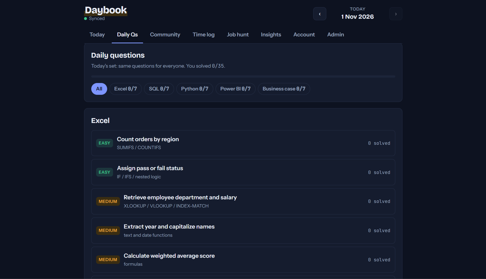
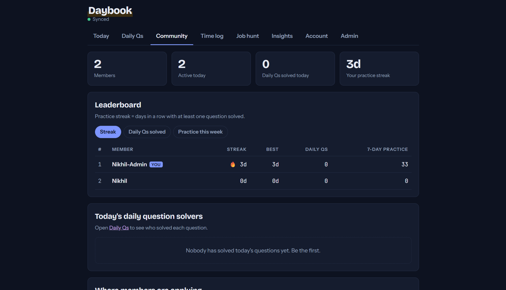
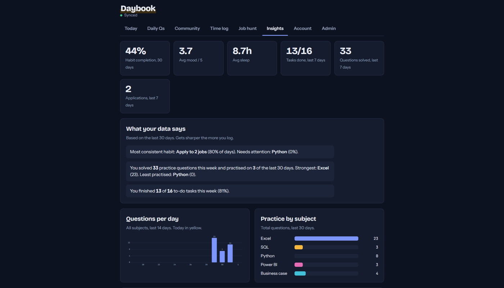
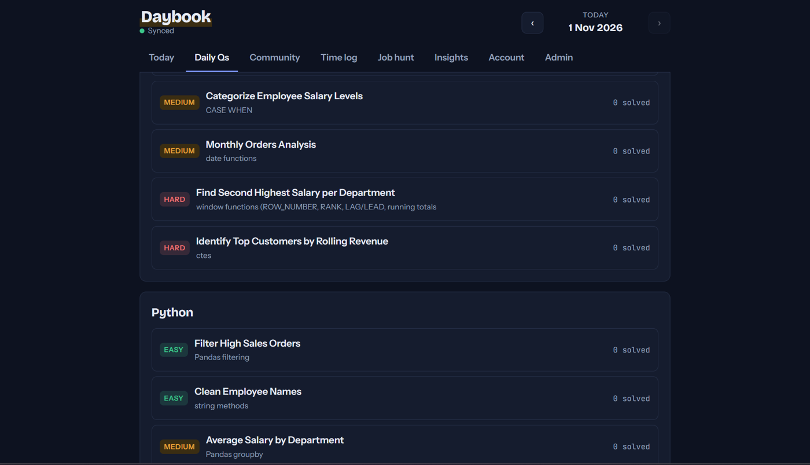
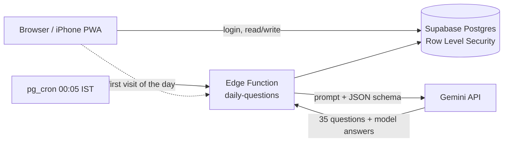

# Daybook

**A daily practice and job-hunt tracker for aspiring data analysts, with AI-generated interview questions and a community leaderboard.**

### 🔗 [Open the live app → nikhilmore2003.github.io/daybook](https://nikhilmore2003.github.io/daybook/)

Sign up with any email. Works on laptop and phone, and installs on iPhone/Android like an app (Share → Add to Home Screen).



---

## Why I built it

While preparing for data analyst roles, my practice, applications and habits were scattered across notes, spreadsheets and job portals. I wanted one place to:

- practise **Excel, SQL, Python, Power BI and business cases** every day,
- see whether I'm actually consistent (streaks, weekly totals),
- track every job application and which platforms get responses,
- and practise alongside friends, comparing answers to the same questions.

## Features

| | |
|---|---|
| **Daily Practice** | Every night at 00:05 IST an AI writes 35 new questions (7 per subject: 2 easy, 3 medium, 2 hard) on a real dataset per subject. Everyone gets the same set. You see the data as an Excel grid or tables, write your formula, SQL query or Python code, and press **Run** to see the output and whether it's correct. Submit to unlock the model answer and other members' answers. Data downloads as .xlsx, .csv, .sql or a .py starter. |
| **Community** | Leaderboard by practice streak, questions solved and weekly practice; today's top solvers; every member's job applications with links, searchable by company and platform. |
| **Today** | To-do list with carry-over, personal habits with streaks, mood / energy / productivity check-in, sleep, journal, and a practice log by subject, topic and difficulty. |
| **Job hunt** | Application pipeline (Applied → Online test → Interview → Offer), job link and platform, response rate, follow-up nudges after 7 days. |
| **Insights** | 30-day dashboard: habit completion, sleep vs productivity correlation, questions per day, practice by subject and topic, best-performing job platform. |
| **Export** | CSV export of daily logs and applications for analysis in Pandas or Power BI. |
| **Admin** | Member list with join date, last sign-in and activity, plus a manual trigger for question generation. |

## Screenshots

| Community | Insights |
|---|---|
|  |  |



## How it works



- **Frontend:** a single-page app in plain HTML, CSS and JavaScript, hosted on GitHub Pages. It saves to the device first, then syncs, so it works offline. A service worker makes it installable.
- **Backend:** Supabase (PostgreSQL + Auth). Each user's private data (habits, journal, practice log) is one JSON document per day in an `entries` table.
- **Security:** Postgres **Row Level Security** enforces every rule in the database, not in the browser:
  - users can only read and write their own private entries;
  - other members' answers and the model answer are readable only after you submit your own (`has_submitted()` check);
  - only admins can list members' emails (`admin_members()` function); passwords are never accessible.
- **Run & auto-check in the browser:** Excel formulas run on HyperFormula, SQL on SQLite (sql.js, WebAssembly), Python on Pyodide (real Python + pandas in WebAssembly). The AI also writes a *checker* (reference formula / query / code); the app runs both on the same data and compares the outputs, so correctness never depends on the AI's arithmetic. Power BI answers are checked against a SQL reference query.
- **AI pipeline:** a Supabase Edge Function (Deno/TypeScript) calls Gemini once per subject in parallel, forces a JSON response schema, validates and cleans the output, avoids repeating the last 3 weeks of questions, retries when the model is busy, and fills in only missing subjects on retry. A lock row makes sure only one generation runs per day.

### Data model (simplified)

| Table | What it holds | Who can read |
|---|---|---|
| `entries` | Private daily logs, habits, applications (JSON) | Owner only |
| `members` | Display name, streaks, stats, shared applications | All signed-in members |
| `daily_sets` / `questions` | One set of questions per day | All signed-in members |
| `solutions` | AI model answers | Only after you answer |
| `submissions` | Members' answers | Only after you answer |
| `admins` | Admin users | Edited from SQL only |

## Tech stack

`JavaScript` · `HTML/CSS` · `PostgreSQL` · `SQLite (sql.js)` · `Pyodide` · `HyperFormula` · `Supabase (Auth, RLS, Edge Functions, pg_cron)` · `TypeScript / Deno` · `Gemini API` · `PWA / Service Worker` · `GitHub Pages`

## What I learned

- Designing **row-level security** policies so privacy rules live in the database, including avoiding recursive policies with `security definer` functions.
- Making LLM output reliable: response schemas, defensive parsing, retries with backoff, idempotent daily jobs.
- Offline-first sync between local storage and a remote database.
- Turning personal tracking data into insights: streaks, correlations, funnels and response rates.

## Run your own copy

The full setup (Supabase project, database scripts, AI key, Edge Function, GitHub Pages) is in **[docs/SETUP.md](docs/SETUP.md)**. It takes about an hour and runs on free tiers.

```
index.html                     the app
sw.js, manifest.webmanifest    offline + install support
config.js                      Supabase URL and public anon key
supabase/schema.sql            private entries table + RLS
supabase/schema_v2.sql         community, questions, admin + RLS
supabase/schema_v3.sql         datasets, checkers, correct answers
supabase/functions/daily-questions/index.ts   AI question generator
supabase/cron.sql              nightly schedule
```

---

Excel checks use [HyperFormula](https://hyperformula.handsontable.com/) under its GPLv3 licence.

Built by **Nikhil More** · Data Analyst · Pune
